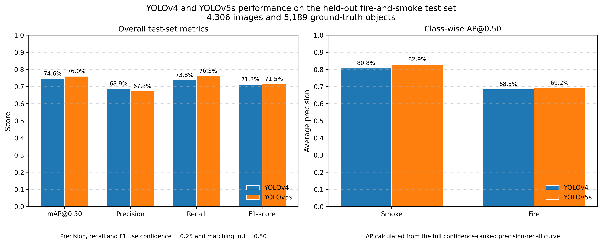
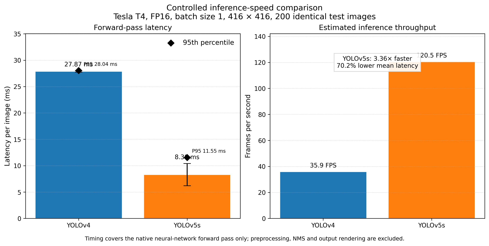
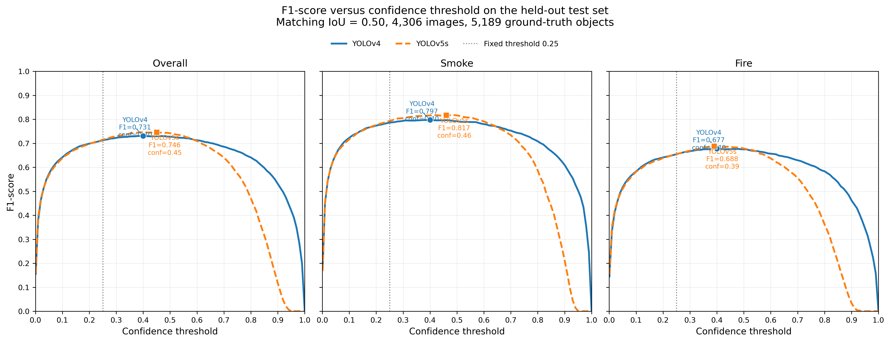
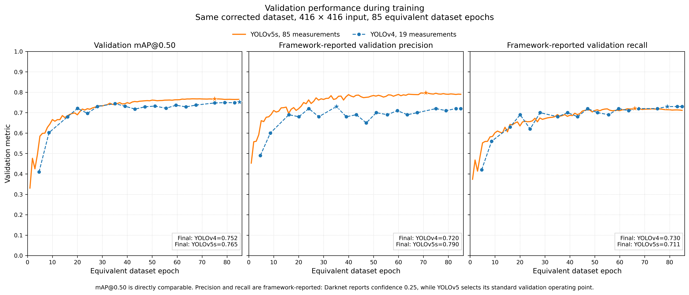

# Real-time fire and smoke detection: YOLOv4 vs YOLOv5s on D-Fire

A controlled comparison of **full YOLOv4** (Darknet) and **YOLOv5s** (PyTorch) for fire and smoke detection, trained on the same corrected version of the D-Fire dataset with the same input size and training length, and evaluated on the same held-out test set.

This repository is the practical part of the research project *Design and Performance Evaluation of a Real-Time Vision-Based Fire and Smoke Detection System Using Deep Learning*.

<!-- DEMO: add a short detection clip here, for example:

-->

## Key result

YOLOv5s matches YOLOv4 on accuracy and is 3.4 times faster on the same GPU, with a model file about 17 times smaller. That makes YOLOv5s the better candidate for embedded deployment.

| Metric (held-out test set) | YOLOv4 | YOLOv5s |
|---|---|---|
| mAP@0.5 | 0.746 | **0.760** |
| AP@0.5, smoke | 0.808 | **0.829** |
| AP@0.5, fire | 0.685 | **0.692** |
| mAP@0.5:0.95 | not measured | 0.417 |
| Precision (confidence 0.25) | **0.689** | 0.673 |
| Recall (confidence 0.25) | 0.738 | **0.763** |
| F1 (confidence 0.25) | 0.713 | **0.715** |
| Best F1 (at confidence) | 0.731 (0.40) | **0.746** (0.45) |
| Mean latency, Tesla T4, batch 1 | 27.87 ms | **8.30 ms** |
| Frames per second | 35.9 | **120.5** |
| Weights file | 244 MB | **14 MB** |

Test set: 4,306 images with 5,189 annotated objects (2,311 smoke, 2,878 fire). Matching IoU is 0.50 throughout. Precision, recall and F1 for both models come from the same matching code, applied to each model's exported predictions.





## More results

**F1-score against confidence threshold.** Both models peak well above the default threshold of 0.25, so a deployed system should use a threshold of about 0.40 to 0.45.



**Validation metrics during training.** YOLOv5 reports metrics every epoch. Darknet reported them at 19 points, which were extracted from its training log.



The data behind every figure is in [`results/`](results).

## Experimental setup

| Setting | YOLOv4 | YOLOv5s |
|---|---|---|
| Framework | AlexeyAB Darknet, commit `59596d7` | Ultralytics YOLOv5 (PyTorch) |
| Model | full YOLOv4, 162 layers | YOLOv5s, 7.0 M parameters |
| Input size | 416 x 416 | 416 x 416 |
| Training length | 18,298 iterations at batch 64 (85 epochs) | 85 epochs at batch 16 |
| Learning rate, momentum | 0.001, 0.949 | 0.01, 0.937 (SGD) |
| Mosaic augmentation | on | on |
| Multi-scale training | off | off |
| Anchors | YOLOv4 defaults | YOLOv5 defaults with automatic anchor check |
| Hardware | Google Colab, Tesla T4 | Google Colab, Tesla T4 |

Config files for both models are in [`configs/`](configs). `custom_yolov5s.yaml` is the standard `yolov5s.yaml` with the number of classes set to 2.

## Dataset

[D-Fire](https://github.com/gaiasd/DFireDataset) contains 21,527 images annotated in YOLO format with two classes: `smoke` (0) and `fire` (1). It is published as a training part (17,221 images) and a test part (4,306 images). The dataset is not included in this repository.

Two problems were fixed before the reported experiments.

**1. Validation on the test set.** The first YOLOv5 run used the D-Fire test part for validation as well as for testing, so the model selection was not independent of the test set. The training part was therefore split again:

| Split | Images | Source |
|---|---|---|
| Train | 13,777 | D-Fire training part |
| Validation | 3,444 | D-Fire training part |
| Test | 4,306 | D-Fire test part, unchanged |

The split is a seeded random shuffle (seed 42) and is exactly reproducible with [`scripts/make_split.py`](scripts/make_split.py). The file names in each split are listed in [`configs/splits/`](configs/splits).

**2. Invalid annotations.** An audit found invalid annotations in 26 label files: 18 zero-area boxes, which were removed, and 8 boxes larger than the image, which were clipped to the image borders. 13 of the files are in train, 1 in validation and 12 in test. Every change is recorded in [`results/correction_log.txt`](results/correction_log.txt).

Both models were trained and evaluated on this corrected dataset.

## Repository structure

```
fire-smoke-detection-yolo/
├── notebooks/
│   ├── yolov4_darknet_train.ipynb        Darknet build and YOLOv4 training
│   ├── yolov4_test_evaluation.ipynb      YOLOv4 test metrics, comparison figures, speed benchmark
│   └── yolov5s_dfire_train_eval.ipynb    YOLOv5s training, evaluation and speed benchmark
├── configs/
│   ├── yolov4-fire-smoke.cfg             YOLOv4 network and training settings
│   ├── obj.data, obj-test.data, obj.names   Darknet dataset files
│   ├── custom_yolov5s.yaml               YOLOv5s model config
│   ├── DFire_corrected.yaml              YOLOv5 dataset config
│   └── splits/                           file names in the train and validation splits
├── scripts/
│   ├── make_split.py                     create the train / validation / test split
│   ├── audit_and_correct_labels.py       find and correct invalid annotations
│   └── prepare_darknet_files.py          image lists and label placement for Darknet
├── raspberry_pi/
│   ├── pi_yolov5s_camera_logging.py      live YOLOv5s detection on the Pi camera with CSV logging
│   └── pi_yolov4_camera_logging.py       live YOLOv4 detection on the Pi camera with CSV logging
└── results/                              figures, metric tables and the correction log
```

## Reproducing the experiments

Everything runs on Google Colab with a GPU runtime. The notebooks and scripts expect the project at `MyDrive/Fire_smoke_detection` on Google Drive; change the `ROOT` or `PROJECT` path at the top of each file if yours differs.

1. Download D-Fire into `data/raw/DFireDataset` (with `train/images`, `train/labels`, `test/images`, `test/labels`).
2. From a clone of this repository, run `python scripts/make_split.py`, then `python scripts/audit_and_correct_labels.py` (set `APPLY = True` in the file to write the corrections), then `python scripts/prepare_darknet_files.py`.
3. Copy the files from `configs/` to `configs/YOLOv4/` on Drive (the YOLOv5 notebook writes its own configs).
4. Train YOLOv4 with `yolov4_darknet_train.ipynb`.
5. Run sections 1 to 4 of `yolov4_test_evaluation.ipynb`.
6. Run sections 1 to 8 of `yolov5s_dfire_train_eval.ipynb`.
7. Run sections 5 to 8 of `yolov4_test_evaluation.ipynb`, then section 9 of the YOLOv5 notebook.

Steps 5 to 7 alternate because each notebook reads comparison files written by the other. Trained weights are not included in the repository because of their size.

## Running on a Raspberry Pi

Both trained models were run live on a Raspberry Pi with the Pi camera. The scripts are in [`raspberry_pi/`](raspberry_pi):

| Script | Model | Runtime |
|---|---|---|
| `pi_yolov5s_camera_logging.py` | YOLOv5s | PyTorch on the CPU, using the YOLOv5 repository |
| `pi_yolov4_camera_logging.py` | YOLOv4 | OpenCV DNN on the CPU, reading the Darknet `.cfg` and `.weights` directly |

Each script captures 1280 x 720 frames with Picamera2, runs detection at 416 x 416 with a confidence threshold of 0.31 and an NMS threshold of 0.45, shows the annotated video, and writes one CSV row per frame with the detections, confidence scores, latency and frames per second.

Setup on the Pi (Raspberry Pi OS with a desktop session):

```
sudo apt install -y python3-picamera2
python3 -m venv --system-site-packages ~/fire_smoke_detection/venv
source ~/fire_smoke_detection/venv/bin/activate

# YOLOv5s only
git clone https://github.com/ultralytics/yolov5 ~/fire_smoke_detection/yolov5
pip install -r ~/fire_smoke_detection/yolov5/requirements.txt

# YOLOv4 only
pip install opencv-python numpy
```

Picamera2 is installed with `apt`, not `pip`, so the virtual environment must be created with `--system-site-packages` to see it. Then copy the trained weights into `~/fire_smoke_detection/models/` as described at the top of each script, and run for example:

```
python raspberry_pi/pi_yolov5s_camera_logging.py --test-name normal_room --duration 60
```

The package versions used on the Pi were not recorded, so these steps install current versions.

## Limitations

- **The reported speed figures are from a Tesla T4, not from embedded hardware.** The two models also run in different runtimes (Darknet and PyTorch, both with half precision). The latency figures cover the network forward pass only, without preprocessing or non-maximum suppression. Raspberry Pi measurements are not included in this repository yet.
- **One training run per model.** No repeated runs were made, so the small accuracy differences between the models (for example F1 of 0.713 against 0.715) should not be read as significant.
- **Prediction export settings.** The YOLOv4 predictions used for the common precision, recall and F1 calculation were exported with Darknet's `detector valid` command, which applies its own built-in confidence and NMS settings. These may not be identical to the NMS IoU of 0.50 used for YOLOv5s. The mAP figures are not affected, because they come from each framework's own evaluation.
- **Anchors.** YOLOv4 used its default anchors; YOLOv5 ran its automatic anchor check. The models were not given identical anchor treatment.
- **Software versions.** The YOLOv5 code was a copy from about May 2026 whose exact commit was not recorded. The Darknet build used for training was not pinned to a commit; the evaluation build was.
- **Training notebook.** `yolov4_darknet_train.ipynb` contains the command that resumes training from a checkpoint, not the first launch.
- **Dataset scripts.** `audit_and_correct_labels.py` and `prepare_darknet_files.py` were written for this repository to reproduce the recorded corrections and file lists. They are not the original session code.

## Acknowledgements

- **D-Fire dataset:** Pedro Vinícius Almeida Borges de Venâncio, Adriano Chaves Lisboa, Adriano Vilela Barbosa. *An automatic fire detection system based on deep convolutional neural networks for low-power, resource-constrained devices.* Neural Computing and Applications, 2022. [github.com/gaiasd/DFireDataset](https://github.com/gaiasd/DFireDataset)
- **YOLOv4 / Darknet:** [github.com/AlexeyAB/darknet](https://github.com/AlexeyAB/darknet)
- **YOLOv5:** [github.com/ultralytics/yolov5](https://github.com/ultralytics/yolov5)
